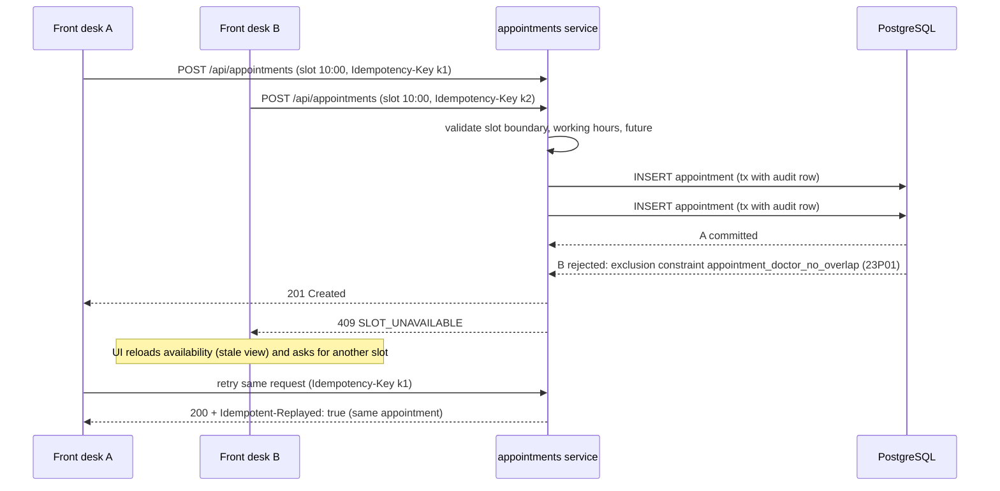
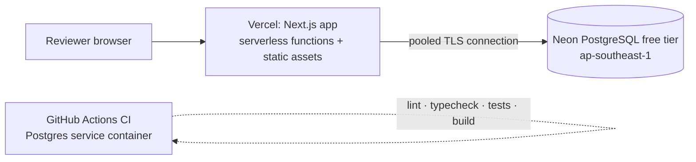

# Architecture

## Overview

The system is a **modular monolith**: one deployable Next.js application. Code is split into layers with a single
dependency direction, **UI → HTTP → services → domain/persistence**, so business rules never live in React
components or route handlers.

```mermaid
flowchart LR
  subgraph Browser
    UI[React pages & forms<br/>src/app, src/components]
  end
  subgraph "Next.js server (Vercel function / node)"
    MW[middleware.ts<br/>redirect anonymous users]
    RH[Route handlers<br/>src/app/api/**/route.ts]
    RW[route wrapper<br/>auth → RBAC → Zod → error map<br/>src/server/http/api.ts]
    RSC[Server components<br/>requirePermission guard]
    SVC[Services / use cases<br/>src/server/services/*]
    DOM[Domain rules (pure)<br/>slots · state machine · reconciliation]
    AUD[Audit service]
    GW[Sandbox payment gateway]
    PR[Prisma client]
  end
  DB[(PostgreSQL<br/>constraints · exclusion · triggers)]

  UI -- fetch JSON --> MW --> RH --> RW --> SVC
  UI -- navigation --> MW --> RSC --> SVC
  SVC --> DOM
  SVC --> AUD --> PR
  SVC --> GW
  SVC --> PR --> DB
```

| Layer | Location | Responsibility |
|---|---|---|
| Presentation | `src/app/(app)/**/page.tsx`, `src/components` | Rendering, forms, loading/empty/error states. Pages call `requirePermission()` first. |
| HTTP | `src/app/api/**/route.ts`, `src/server/http` | Parse + validate (Zod), authenticate, coarse RBAC, map errors to a stable JSON envelope. Handlers are 2–5 lines. |
| Application services | `src/server/services` | Use cases, record-level authorization, transactions, audit writes. |
| Domain | `src/server/domain`, `src/lib/money.ts`, `src/lib/time.ts` | Pure, unit-tested rules: slot generation, appointment state machine, invoice math and reconciliation. |
| Persistence | `prisma/schema.prisma`, `prisma/migrations` | Relational model, indexes, constraints, exclusion constraints, audit trigger. |

## Authentication & authorization

* `POST /api/auth/login` verifies the bcrypt hash and issues an **HS256 JWT** in an `httpOnly`, `SameSite=Lax`
  (and `Secure` in production) cookie, valid for 8 hours. The token holds ids and role only.
* **Defence in depth:**
  1. `middleware.ts` redirects anonymous page requests to `/login` (a convenience only).
  2. Every page calls `requirePermission(...)` on the server before loading data.
  3. Every API route goes through `route({ permission })`, which returns 401/403. A 403 writes an `ACCESS_DENIED` audit entry.
  4. Every service calls `assertCan(role, permission)` again and applies **record-level** rules: clinicians act only on
     their own appointments/visits and read visits only within their care relationships, patients only on their own
     records, and front desk never receives clinical content.

## Scheduling: why double booking cannot happen



* `EXCLUDE USING gist (doctorId WITH =, tsrange(startTime,endTime) WITH &&) WHERE status IN (active)`: the database
  rejects overlapping active appointments atomically, regardless of timing. The same constraint exists per patient.
* Cancelled and no-show appointments are excluded from the constraint, so the slot is free again.
* State changes (`reschedule`, `cancel`, `check-in`, …) use `UPDATE … WHERE id = ? AND version = ?`
  (**optimistic locking**). A stale screen gets `409 STALE_VERSION` instead of overwriting newer data.
* The appointment **state machine** (`src/server/domain/appointment-state.ts`) lists the legal transitions and which roles may
  perform them.

## Billing: integrity

* Line amounts and invoice totals are always recomputed from line items in the transaction that changes them, and
  PostgreSQL `CHECK` constraints reject inconsistent rows (`lineTotal = qty × unit + tax`, `total = subtotal + tax − discount`, `amountPaid ≤ total`).
* Payment flow: (1) idempotency check → (2) `SELECT … FOR UPDATE` on the invoice, balance check including in-flight
  PENDING payments, insert PENDING payment → (3) call the sandbox gateway outside the transaction → (4) lock again, settle
  the payment (SUCCEEDED/FAILED), update `amountPaid`, and move to PAID when the balance reaches zero, with the audit entry in the same transaction.
* `reconcileInvoice()` re-derives every amount from line items and successful payments and reports mismatches. It is shown on each
  invoice and run over all invoices in the billing report.

## Audit trail

`audit()` is called by services, inside the same transaction as the change where there is one. It records actor, role, action, entity,
patient and small metadata (field names, not values). A PostgreSQL trigger raises an exception on any UPDATE or DELETE of
`AuditLog`, so the trail is append-only even for code with database access.

## Deployment topology (demo)



See [`ER_DIAGRAM.md`](ER_DIAGRAM.md) for the data model.
