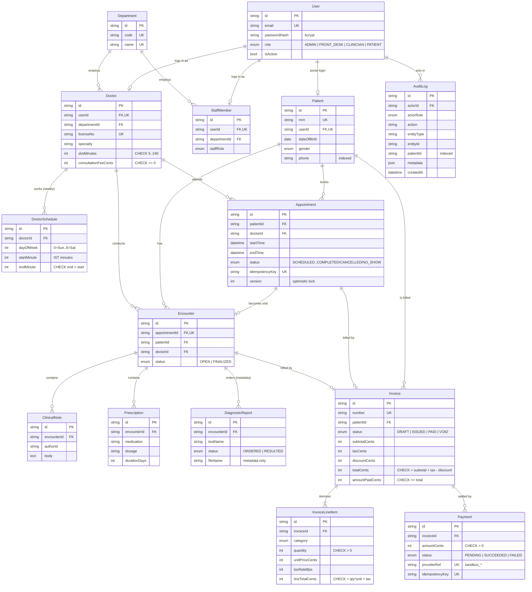

# Entity–Relationship Diagram

Source of truth: [`prisma/schema.prisma`](../prisma/schema.prisma) and the SQL in
[`prisma/migrations`](../prisma/migrations). GitHub renders the Mermaid diagram below.

## Integrity rules enforced by the database

| Rule | Mechanism |
|---|---|
| No two active appointments overlap for the same doctor | `EXCLUDE USING gist (doctorId WITH =, tsrange(start,end) WITH &&) WHERE status IN (SCHEDULED, CHECKED_IN, COMPLETED)` |
| A patient is never double-booked | Same exclusion constraint on `patientId` |
| Duplicate "book" submissions create one appointment | `UNIQUE(idempotencyKey)` |
| One visit per appointment, one invoice per visit | `UNIQUE(appointmentId)` on Encounter / Invoice |
| Line totals and invoice totals reconcile | `CHECK` constraints on `InvoiceLineItem` and `Invoice` |
| An invoice can never be over-paid | `CHECK (amountPaidCents <= totalCents)` |
| Duplicate payment submissions are charged once | `UNIQUE(idempotencyKey)` on Payment |
| Audit trail cannot be edited or deleted | `BEFORE UPDATE OR DELETE` trigger raising an exception |

## Indexes
Search and listing paths are indexed: patient name/phone, appointments by
`(doctorId,startTime)`, `(patientId,startTime)`, `(status,startTime)`, invoices by
`(status,createdAt)`, audit log by entity, patient, actor and time.
